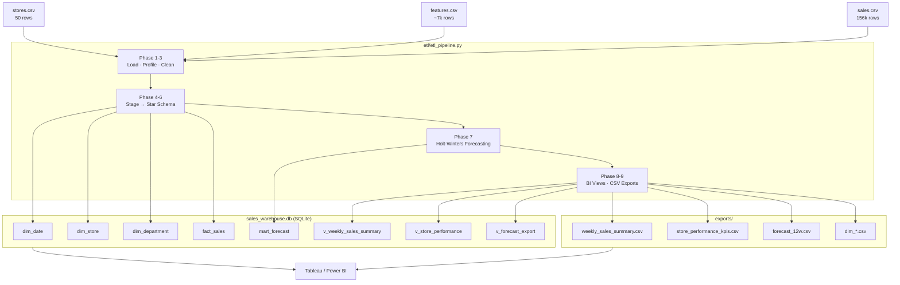

# Sales Forecasting Dashboard

> End-to-end ETL pipeline, star-schema data warehouse, Holt-Winters forecasting model, and BI-ready export layer for 3 years of retail sales data.

---

## Architecture



---

## Quick Start

### 1. Install Python dependencies

```bash
cd "Sales Forecasting Dashboard"
pip install -r etl/requirements.txt
```

### 2. Run the full pipeline

```bash
python etl/etl_pipeline.py
```

This single command:
- Loads and cleans all 3 source CSVs
- Builds the SQLite star-schema database (`sales_warehouse.db`)
- Trains ~1,000 Holt-Winters time-series models
- Exports 6 BI-ready CSV files to `exports/`

**Expected runtime:** 3–6 minutes (depending on CPU)

### 3. Connect your BI tool

See [`docs/bi_connection_guide.md`](bi_connection_guide.md) for step-by-step Tableau and Power BI setup.

---

## Project Structure

```
Sales Forecasting Dashboard/
├── sales.csv                   ← Raw: 156k weekly store×dept sales rows
├── features.csv                ← Raw: macro + markdown data per store×week
├── stores.csv                  ← Raw: store metadata (type, size, region)
│
├── sql/
│   ├── 01_schema_create.sql    ← Star schema DDL (dims + fact + mart)
│   ├── 02_raw_ingest.sql       ← Staging table definitions
│   ├── 03_transform_load.sql   ← Clean + upsert into star schema
│   └── 04_bi_views.sql         ← Analytics views (BI connector layer)
│
├── etl/
│   ├── etl_pipeline.py         ← 10-phase ETL orchestrator (run this)
│   └── requirements.txt        ← Python dependencies
│
├── forecasting/
│   └── forecaster.py           ← Holt-Winters model (per store×dept series)
│
├── exports/                    ← Generated at runtime
│   ├── weekly_sales_summary.csv
│   ├── store_performance_kpis.csv
│   ├── forecast_12w.csv
│   ├── dim_date.csv
│   ├── dim_store.csv
│   └── dim_department.csv
│
├── sales_warehouse.db          ← Generated at runtime (SQLite)
│
└── docs/
    ├── README.md               ← This file
    ├── schema_reference.md     ← Full data dictionary
    └── bi_connection_guide.md  ← Tableau & Power BI setup guide
```

---

## Forecasting Model

The forecaster uses **Holt-Winters Triple Exponential Smoothing** from `statsmodels`:

| Parameter | Value | Rationale |
|---|---|---|
| `trend` | `additive` | Linear growth observed in data |
| `seasonal` | `multiplicative` | Variance scales with level (common in retail) |
| `seasonal_periods` | `52` | One full calendar year of weekly cycles |
| `damped_trend` | `True` | Prevents over-extrapolation at 12-week horizon |
| Horizon | 12 weeks | Covers a full planning quarter |
| Confidence | 95% | Via bootstrap simulation (200 draws) |

**Fallback:** Series with < 26 historical weeks use a naive seasonal repeat.

**Stockout Risk Flag:** Set to `1` when predicted sales > 115% of the rolling 8-week average — indicating potential demand spike relative to recent supply baseline.

---

## Key Metrics Available

| Metric | Source View / Export |
|---|---|
| Weekly revenue per store/dept | `v_weekly_sales_summary` |
| YoY revenue growth % | `v_store_performance` |
| Holiday sales lift % | `v_store_performance` |
| Revenue rank by year | `v_store_performance` |
| 12-week sales forecast | `v_forecast_export` |
| Forecast confidence intervals | `v_forecast_export` |
| Stockout risk alerts | `v_forecast_export` |
| Markdown spend impact | `v_weekly_sales_summary` |

---

## Data Quality Rules Applied

| Issue | Action |
|---|---|
| Negative `weekly_sales` | Zeroed (returns / reversals) |
| NULL markdown values | Filled with `0.0` (no active discount) |
| NULL CPI / unemployment | Forward-filled per store, then back-filled |
| Duplicate (store, dept, date) | First occurrence retained |
| Non-parseable dates | Row dropped |
| Missing store in stores.csv | Row dropped from fact |
